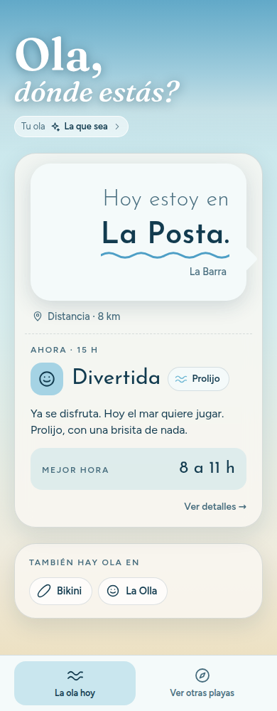
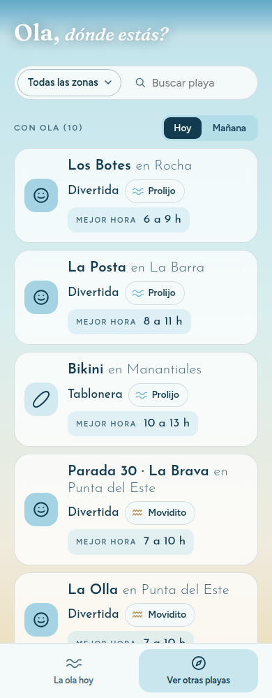
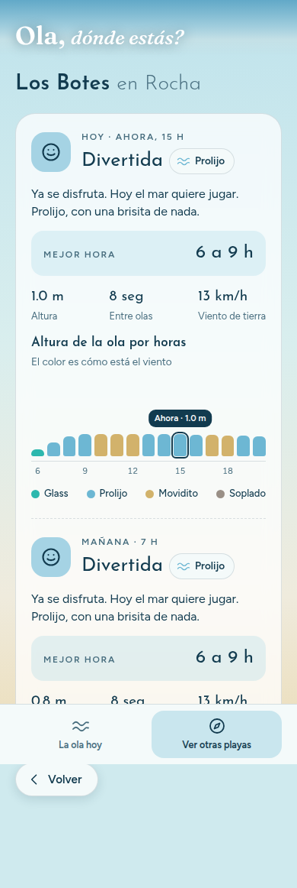

# Ola, dónde estás?

**A simple app that tells you where the waves are, from Punta del Este to Rocha (Uruguay).**

👉 **Try it on your phone:** https://agustinabergara.github.io/ola-donde-estas/

| Home | Explore | Detail |
|---|---|---|
|  |  |  |

## The problem
Surf apps give you charts, wind arrows and numbers. You need to know about wind and swell to read them. Most people just want to know: *where should I go today?*

## The idea
Answer "where" in plain, local words, with no need to understand wind or think. 11 beaches, one clear answer.

## Who it's for
First, friends who surf around José Ignacio. It's a test: if they use it, it may become a real product.

## Product decisions
- **Size of the wave, in everyday words.** Instead of only meters, waves have names (from beginner-friendly to radical).
- **Wind quality in 4 simple levels:** Glass, Prolijo, Movidito, Soplado. They are based on the Beaufort wind scale, not invented. Gusts count, and offshore wind helps, but never gives "Glass" by itself.
- **Real-life validation.** I checked the app against a live weather station and Windguru. The forecast model underestimated the wind, so the rules got stricter.
- **A chart that says something.** Bars show wave height by hour. Color shows the wind quality. No legend hunting.
- **Installable (PWA).** It works from the home screen like an app, with no store.

## What I'd measure next
- Friends opening it at least 2 times a week
- Accuracy: ~7 out of 10 times the app matches what they find at the beach
- Someone I don't know recommending it

## Built with
Plain HTML, CSS and JavaScript in one file. Wave and wind data from [Open-Meteo](https://open-meteo.com/). Built together with Claude.

## Repo
- `docs/`: the published app
- `src/`: files used to build it
- `screenshots/`: images for this page
